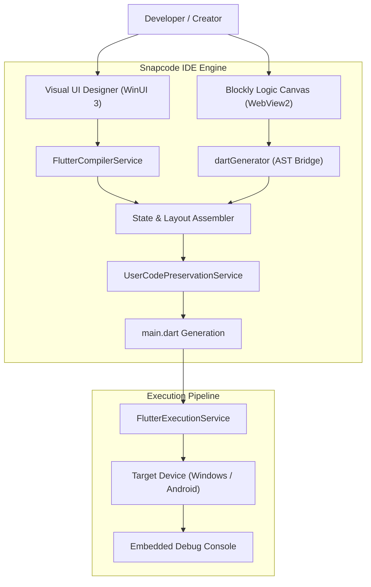

# Snapcode

<p align="center">
  <strong>Visual Drag-and-Drop &amp; Block-Based Flutter App Builder for Windows</strong>
</p>

<p align="center">
  
  
  
  
  
</p>

---

## 📖 Overview

**Snapcode** is a next-generation visual integrated development environment (IDE) that empowers developers and creators to design, build, and deploy production-ready **Flutter** applications visually.

Inspired by mobile visual development environments like **Sketchware Pro** and powered by **Google Blockly**, Snapcode bridges the gap between no-code visual prototyping and professional software engineering. It automatically compiles visual layout trees and logic blocks into clean, idiomatic Flutter Dart source code while preserving custom developer code across regenerations.

---

## ✨ Key Features

### 🎨 Visual Native UI Designer
- **Drag-and-Drop Canvas:** Seamlessly build complex UI hierarchies using responsive layout containers (`Row`, `Column`, `Container`, `Card`, `Grid`).
- **Interactive Flutter Widgets:** Pre-built visual widgets including `ElevatedButton`, `Text`, `TextField`, `Image`, `Switch`, `Checkbox`, and more.
- **Real-Time Property Inspector:** Customize colors, padding, margins, alignment, typography, and dimensions with instantaneous visual feedback.

### 🧩 Sketchware-Inspired Visual Event Logic (Blockly)
- **Visual Block Workflow:** Event handlers for widget interactions (`onClick`, `onChanged`) and Flutter lifecycle hooks (`initState`, `build`, `dispose`).
- **Lists & Collections:** Create filled lists (`List.filled`), matrix winning pattern arrays, get/set list elements by index, and check list emptiness.
- **Control Flow & Boolean Logic:** `for-each` loops, compound `AND`/`OR` gates, ternary toggles, and dynamic function calls.
- **Dynamic State Declarations:** Visually declare state variables (`String`, `int`, `bool`, `List<String>`) that automatically register in Flutter state classes.
- **Interactive Dialogs & Modals:** Visual blocks to show alert dialogs with custom actions and buttons.
- **Zero Raw-Code Requirement:** Author complete interactive applications and games (like Tic-Tac-Toe) purely using visual blocks.

### 🛡️ Bi-Directional Code Preservation
- **Preservation Markers:** Custom developer code inside marker tags (`CUSTOM_IMPORTS`, `CUSTOM_METHODS`, `STATE_VARS`) is never overwritten when UI or blocks are modified.
- **Orphan Block Archival:** Deleted canvas widgets gracefully archive their associated event blocks without data loss.

### ⚡ Integrated Flutter Toolchain & Runner
- **Live Device Discovery:** Enumerate connected physical Android devices, emulators, and Windows desktop targets.
- **One-Click Runner:** Compile, execute, and stream live stdout/stderr debug logs directly within the Snapcode IDE.
- **Instant Hot Reload:** Push UI and logic updates instantly without restarting the application.

---

## 🏗️ Architecture Overview



---

## 📦 Download & Installation

Pre-built binaries for Windows 10/11 (x64) are available on our [Releases Page](releases/):

| Package | Type | Description |
| :--- | :--- | :--- |
| **`Snapcode-Setup-v0.1.0.exe`** | Setup Wizard | Inno Setup installation wizard with Start Menu and Desktop shortcuts. |
| **`Snapcode-ThinInstaller.exe`** | Thin Installer | Ultra-fast lightweight GUI installer installing directly to user profile. |
| **`Snapcode-v0.1.0-win-x64.zip`** | Portable ZIP | Zero-install standalone archive. Extract and run `Snapcode.exe`. |

For cryptographic checksums, refer to [`releases/SHA256SUMS.txt`](releases/SHA256SUMS.txt).

---

## 🚀 Building from Source

### Prerequisites
- Windows 10 (Build 19041+) or Windows 11
- [.NET 8.0 SDK](https://dotnet.microsoft.com/download/dotnet/8.0)
- [Visual Studio 2022](https://visualstudio.microsoft.com/) with **.NET Desktop Development** and **Windows App SDK** workloads.
- [Flutter SDK 3.19+](https://flutter.dev/docs/get-started/install/windows)

### Build Instructions

1. **Clone the repository:**
   ```bash
   git clone https://github.com/hkpc-labs/snapcode.git
   cd snapcode
   ```

2. **Build the WinUI 3 Desktop App:**
   ```powershell
   dotnet build src/Snapcode.csproj -c Release -p:Platform=x64
   ```

3. **Generate Production Installers and Release Packages:**
   ```powershell
   powershell -ExecutionPolicy Bypass -File scripts\Build-Release.ps1
   ```

---

## 📂 Repository Structure

- **[`src/`](src/)**: WinUI 3 application source code (Views, ViewModels, Services, Models, Assets).
- **[`installer/`](installer/)**: Inno Setup script (`Snapcode-Installer.iss`) and WPF `ThinInstaller` project.
- **[`releases/`](releases/)**: Production release builds, quick-launch scripts, and checksums.
- **[`scripts/`](scripts/)**: Build, test, and verification automation scripts.
- **[`Docs/`](Docs/)**: Specifications, architectural deep-dives, and system verification reports.
- **[`CONTRIBUTING.md`](CONTRIBUTING.md)**: Guidelines for contributing, code style, and PR workflow.
- **[`RELEASE_NOTES.md`](RELEASE_NOTES.md)**: Detailed changelog and release notes for v0.1.0.

---

## 🤝 Contributing

We welcome contributions! Please review our [**Contributing Guide**](CONTRIBUTING.md) to get started with development, commit conventions, and pull request procedures.

---

## 📄 License & Publisher

Developed and maintained with ❤️ by **hkpc labs**.  
For inquiries, bug reports, and suggestions, please open a GitHub Issue or Pull Request.
